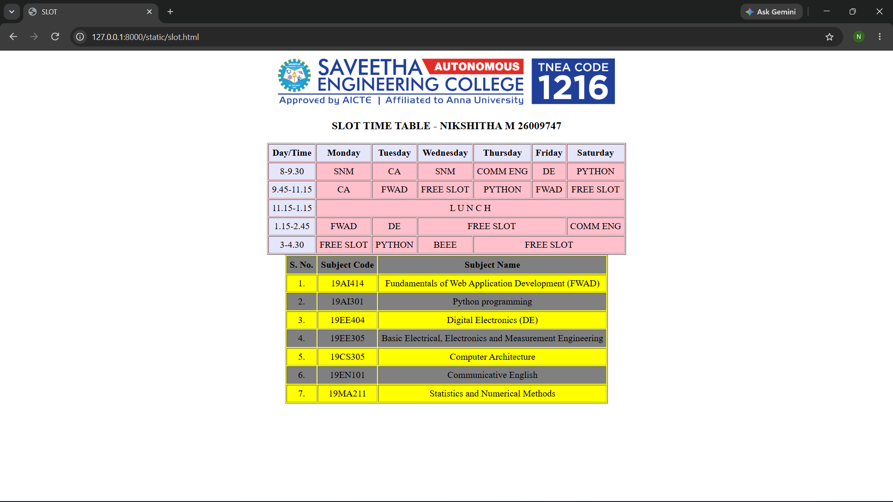

# Ex02 Time Table
## Date:17.11.2026

## AIM
To write a html webpage page to display your slot timetable.

## ALGORITHM
### STEP 1
Create a Django-admin Interface.

### STEP 2
Create an App inside the Django project.

### STEP 2
Create a static folder uder the created App and insert HTML code.

### STEP 3
Create a simple table using ```<table>``` tag in html with the relevant attributes.

### STEP 4
Add rows using ```<tr>``` tag.

### STEP 5
Add your course schedule using ```<td>``` tag.

### STEP 6
Execute the program using runserver command.

## PROGRAM
```
<html>
    <head>
        <title> SLOT </title>
    </head>
    <body>
        <h2 align="center"></h2>
        <h3 align="center"><b>SLOT TIME TABLE - NIKSHITHA M 26009747</b></h3>
        <table border="1.5" align="center" cellspacing="2" cellpadding="5" bgcolor="pink">
            <tr align="center" bgcolor="lavender">
                <th>Day/Time</th>
                <th>Monday</th>
                <th>Tuesday</th>
                <th>Wednesday</th>
                <th>Thursday</th>
                <th>Friday</th>
                <th>Saturday</th>
            </tr>
            <tr align="center">
                <td bgcolor="lavender">8-9.30</td>
                <td>SNM</td>
                <td>CA</td>
                <td>SNM</td>
                <td>COMM ENG</td>
                <td>DE</td>
                <td>PYTHON</td>
            </tr>
            <tr align="center">
                <td bgcolor="lavender">9.45-11.15</td>
                <td>CA</td>
                <td>FWAD</td>
                <td>FREE SLOT</td>
                <td>PYTHON</td>
                <td>FWAD</td>
                <td>FREE SLOT</td>
            </tr>
            <tr align="center">
                <td bgcolor="lavender">11.15-1.15</td>
                <td colspan="6">L U N C H</td>
            </tr>
            <tr align="center">
                <td bgcolor="lavender">1.15-2.45</td>
                <td>FWAD</td>
                <td>DE</td>
                <td colspan="3">FREE SLOT</td>
                <td>COMM ENG</td>
            </tr>
            <tr align="center">
                <td bgcolor="lavender">3-4.30</td>
                <td>FREE SLOT</td>
                <td>PYTHON</td>
                <td>BEEE</td>
                <td colspan="3">FREE SLOT</td>
            </tr>
        </table>

        <table border="1.5" align="center" cellspacing="2" cellpadding="5" bgcolor="yellow">

            <tr align="center" bgcolor="grey">
                <th>S. No.</th>
                <th>Subject Code</th>
                <th>Subject Name</th>
            </tr>
            <tr align="center">
                <td>1.</td>
                <td>19AI414</td>
                <td>Fundamentals of Web Application Development (FWAD)</td>
            </tr>
            <tr align="center" bgcolor="grey">
                <td >2.</td>
                <td>19AI301</td>
                <td>Python programming</td>
            </tr>
            <tr align="center">
                <td>3.</td>
                <td>19EE404</td>
                <td>Digital Electronics (DE)</td>
            </tr>
            <tr align="center" bgcolor="grey">
                <td>4.</td>
                <td>19EE305</td>
                <td>Basic Electrical, Electronics and Measurement Engineering</td>
            </tr>
            <tr align="center">
                <td>5.</td>
                <td>19CS305</td>
                <td>Computer Architecture</td>
            </tr>
            <tr align="center" bgcolor="grey">
                <td>6.</td>
                <td>19EN101</td>
                <td>Communicative English</td>
            </tr>
            <tr align="center">
                <td>7.</td>
                <td>19MA211</td>
                <td>Statistics and Numerical Methods</td>
            </tr>
        </table>
    </body>
</html>
```
## OUTPUT


## RESULT
The program for creating slot timetable using basic HTML tags is executed successfully.
